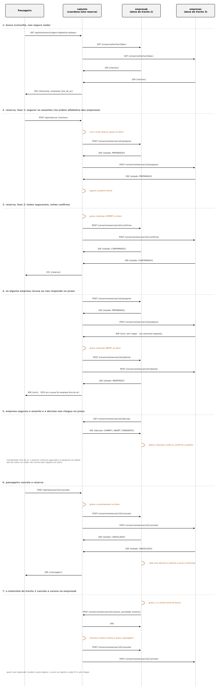

# API REST do consórcio

Cada empresa serve duas APIs na mesma porta (padrão 5001):

- `/api/...` para os clientes da própria empresa (motorista e passageiro)
- `/consorcio/...` para as outras empresas

Corpo e resposta sempre em JSON. Datas em `DD/MM/AAAA`, horários em `HH:MM`.

Toda requisição e toda resposta carrega o cabeçalho `X-Relogio` com o valor do
relógio lógico de Lamport de quem enviou. Quem recebe faz
`relogio = max(relogio, recebido) + 1`.



## Identificador da reserva

Cada reserva tem um `id_reserva` criado pela empresa que recebeu o pedido do
passageiro (a coordenadora daquela reserva):
`<relogio>-<empresa>-<6 hex>`, por exemplo `00000011-vaijunto-7a0e14`. As outras
empresas só conhecem o `id_reserva` e os trechos. O nome do passageiro nunca sai
da empresa dele.

---

## API entre empresas (`/consorcio`)

| Método | Recurso | Para quê |
|---|---|---|
| GET | `/consorcio/trechos?data=` | trechos com vaga numa data |
| POST | `/consorcio/reservas/{id}/preparar` | segurar assentos (fase 1) |
| POST | `/consorcio/reservas/{id}/confirmar` | decisão COMMIT (fase 2) |
| POST | `/consorcio/reservas/{id}/abortar` | decisão ABORT (fase 2) |
| POST | `/consorcio/reservas/{id}/cancelar` | a reserva confirmada foi cancelada: devolver os assentos |
| POST | `/consorcio/reservas/{id}/carona_cancelada` | a dona de um trecho avisa a coordenadora que o motorista cancelou a carona |
| GET | `/consorcio/reservas/{id}/decisao` | a coordenadora diz como a reserva terminou |
| GET | `/consorcio/auditoria` | fotografia do estado (testes) |

### GET /consorcio/trechos?data=10/12/2026

Resposta `200`:

```json
{
  "empresa": "empresab",
  "trechos": [
    {"empresa": "empresab", "id_carona": "c2d6...", "posicao": 0,
     "origem": "Feira de Santana", "destino": "Vitoria da Conquista",
     "data": "10/12/2026", "horario": "08:00", "preco": 35.0,
     "assentos": 4, "livres": 3, "retidos": 1}
  ]
}
```

`livres` são os assentos ainda não confirmados. `retidos` são os que estão
segurados por reservas em andamento. Erro `400` se a data for inválida.

### POST /consorcio/reservas/{id}/preparar

Pede à empresa que segure um assento em cada trecho listado. Ou segura todos os
trechos pedidos a esta empresa, ou nenhum.

```json
{
  "prioridade": [17, "vaijunto"],
  "coordenadora": "vaijunto",
  "trechos": [{"id_carona": "c2d6...", "posicao": 0}]
}
```

- `prioridade`: `[relogio de Lamport, empresa]` do pedido. Define quem passa primeiro em disputa.
- `coordenadora`: a quem perguntar como a reserva terminou, se a decisão demorar.

Respostas:

| Código | Quando | Corpo |
|---|---|---|
| 200 | segurado (ou já estava segurado: repetir é inofensivo) | `{"estado": "PREPARADO", "trechos": [{empresa, id_carona, posicao, origem, destino, data, preco}]}` |
| 400 | corpo mal formado (prioridade, coordenadora ou trechos) | `{"erro": "..."}` |
| 409 | sem vaga, trecho muito disputado, carona cancelada, ou a reserva já foi abortada | `{"erro": "..."}` |

### POST /consorcio/reservas/{id}/confirmar

Sem corpo. O assento segurado vira vendido.

| Código | Quando | Corpo |
|---|---|---|
| 200 | confirmado (repetir é inofensivo) | `{"estado": "CONFIRMADO"}` |
| 409 | esta empresa não tem essa reserva preparada, ou ela foi abortada | `{"erro": "..."}` |

### POST /consorcio/reservas/{id}/abortar

Sem corpo. Solta o assento segurado. Se a reserva nunca chegou aqui, deixa uma
marca para recusar um pedido de `preparar` que chegue atrasado.

| Código | Quando | Corpo |
|---|---|---|
| 200 | abortado (repetir é inofensivo) | `{"estado": "ABORTADO"}` |
| 409 | a reserva já foi confirmada aqui | `{"erro": "..."}` |

### POST /consorcio/reservas/{id}/cancelar

Sem corpo. Enviada pela coordenadora quando a reserva confirmada é cancelada
(pelo passageiro ou por causa de uma carona cancelada). O assento volta a ficar
livre e o motorista do trecho recebe um aviso. Repetir é inofensivo.

`200 {"estado": "CANCELADO"}`

### POST /consorcio/reservas/{id}/carona_cancelada

Enviada pela empresa dona da carona cancelada para a coordenadora de cada
reserva confirmada que usava essa carona. A coordenadora cancela a reserva
inteira, avisa o passageiro e manda `cancelar` às demais empresas.

```json
{"motivo": "o motorista cancelou a carona Feira de Santana -> Vitoria da Conquista em 10/12/2026 as 08:00"}
```

`200 {"ok": true}`, também quando a reserva já estava cancelada. A dona da
carona repete o aviso até receber o `cancelar` de volta.

### GET /consorcio/reservas/{id}/decisao

Respondida pela empresa que coordenou a reserva, quando uma dona de trecho
ficou com o assento segurado além do prazo.

| Código | Corpo |
|---|---|
| 200 | `{"decisao": "COMMIT"}`, `{"decisao": "ABORT"}` ou `{"decisao": "PENDENTE"}` (ainda trabalhando) |

Uma reserva que a coordenadora desconhece é respondida como `ABORT`.

---

## API para os clientes (`/api`)

Depois do login, enviar `Authorization: Bearer <token>`. O token fica só na
memória do servidor: se ele reiniciar, o cliente faz login de novo (`401`).

| Método | Recurso | Quem usa | Para quê |
|---|---|---|---|
| POST | `/api/login` | todos | entra (cadastra no primeiro acesso) |
| POST | `/api/caronas` | motorista | publica carona |
| GET | `/api/caronas` | motorista | lista as próprias caronas (sem as canceladas) |
| POST | `/api/caronas/{id}/cancelar` | motorista | cancela a carona |
| GET | `/api/itinerarios?origem=&destino=&data=` | passageiro | busca em todas as empresas |
| POST | `/api/reservas` | passageiro | reserva um itinerário |
| GET | `/api/reservas` | passageiro | lista as próprias reservas (sem as canceladas) |
| POST | `/api/reservas/{id}/cancelar` | passageiro | cancela a reserva |
| GET | `/api/avisos` | todos | avisos de cancelamento recebidos |

### POST /api/login

```json
{"usuario": "ana", "senha": "123"}
```

`200 {"token": "...", "usuario": "ana", "empresa": "vaijunto"}`.
`400` se faltar campo, `401` se a senha estiver errada.

### POST /api/caronas

```json
{"rota": ["Salvador", "Feira de Santana"], "data": "10/12/2026",
 "horario": "08:00", "assentos": 3, "precos": [20.0]}
```

`201 {"id": "...", "empresa": "vaijunto"}`. `400` com o motivo se algo for
inválido (rota com menos de 2 cidades, data inexistente, preços que não batem
com os trechos).

### GET /api/itinerarios

`200`:

```json
{
  "itinerarios": [
    {"trechos": [{"empresa": "vaijunto", "id_carona": "...", "posicao": 0,
                  "origem": "Salvador", "destino": "Feira de Santana",
                  "preco": 20.0, "livres": 3, "horario": "08:00"}],
     "preco_total": 20.0, "conexoes": 1}
  ],
  "empresas_fora_do_ar": []
}
```

Mais curtos primeiro, depois mais baratos. Uma empresa que não responde em 2,5 s
é deixada de fora e listada em `empresas_fora_do_ar`; a busca segue com as demais.

### POST /api/reservas

```json
{"trechos": [
  {"empresa": "vaijunto", "id_carona": "...", "posicao": 0},
  {"empresa": "empresab", "id_carona": "...", "posicao": 0}
]}
```

| Código | Quando | Corpo |
|---|---|---|
| 201 | todos os trechos reservados | `{"id", "passageiro", "trechos": [...], "preco_total", "situacao": "CONFIRMADA"}` |
| 409 | algum trecho sem vaga ou muito disputado; nada foi reservado | `{"erro": "..."}` |
| 503 | alguma empresa do itinerário não respondeu; nada foi reservado | `{"erro": "..."}` |
| 400 | corpo inválido | `{"erro": "..."}` |
| 401 | sem login | `{"erro": "..."}` |

### GET /api/reservas

`200 {"reservas": [{"id", "passageiro", "trechos", "preco_total", "situacao"}]}`.

### POST /api/caronas/{id}/cancelar

Sem corpo. A carona some da busca e da lista do motorista. Cada reserva
confirmada que usava essa carona é cancelada inteira (o itinerário deixou de
existir): o passageiro recebe um aviso, e os assentos nos outros trechos voltam
a ficar livres, com aviso aos motoristas deles.

| Código | Quando | Corpo |
|---|---|---|
| 200 | cancelada | `{"mensagem": "..."}` |
| 409 | a carona não é deste motorista, já foi cancelada, ou tem reserva em andamento | `{"erro": "..."}` |

### POST /api/reservas/{id}/cancelar

Sem corpo. Os assentos de todos os trechos voltam a ficar livres e o motorista
de cada trecho recebe um aviso. A reserva some da lista do passageiro.

| Código | Quando | Corpo |
|---|---|---|
| 200 | cancelada | `{"mensagem": "..."}` |
| 409 | a reserva não é deste passageiro ou já foi cancelada | `{"erro": "..."}` |

### GET /api/avisos

`200 {"avisos": ["um passageiro cancelou Salvador -> Feira de Santana em 10/12/2026 as 08:00. vagas livres: 3 de 3"]}`

---

## Códigos de retorno, em resumo

| Código | Significado |
|---|---|
| 200 | operação feita |
| 201 | carona publicada ou reserva confirmada |
| 400 | requisição mal formada |
| 401 | sem login ou senha errada |
| 409 | conflito: sem vaga, trecho disputado, reserva já abortada/confirmada |
| 503 | uma empresa necessária está fora do ar |

## Prazos

| Prazo | Valor padrão | Variável |
|---|---|---|
| Espera na fila de um trecho disputado, no dono do trecho | 2 s por pedido a uma empresa | `ESPERA_MAX` |
| Assento segurado sem decisão: depois disso, a empresa pergunta | 8 s | `PRAZO_RETENCAO` |
| Aviso a uma empresa (decisão ou cancelamento) | 2 s, repetido a cada 0,5 s até chegar | |
| Pergunta à coordenadora sobre a decisão | 2 s | |
| Resposta de uma empresa na busca | 2,5 s | |
